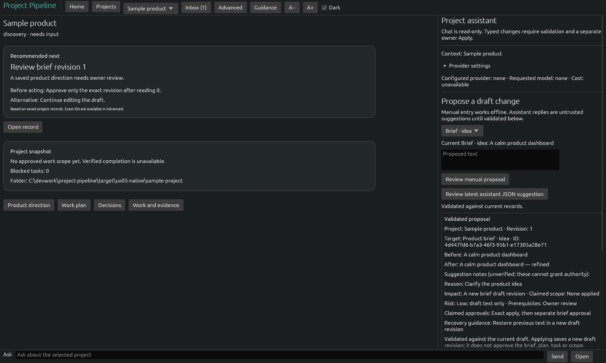
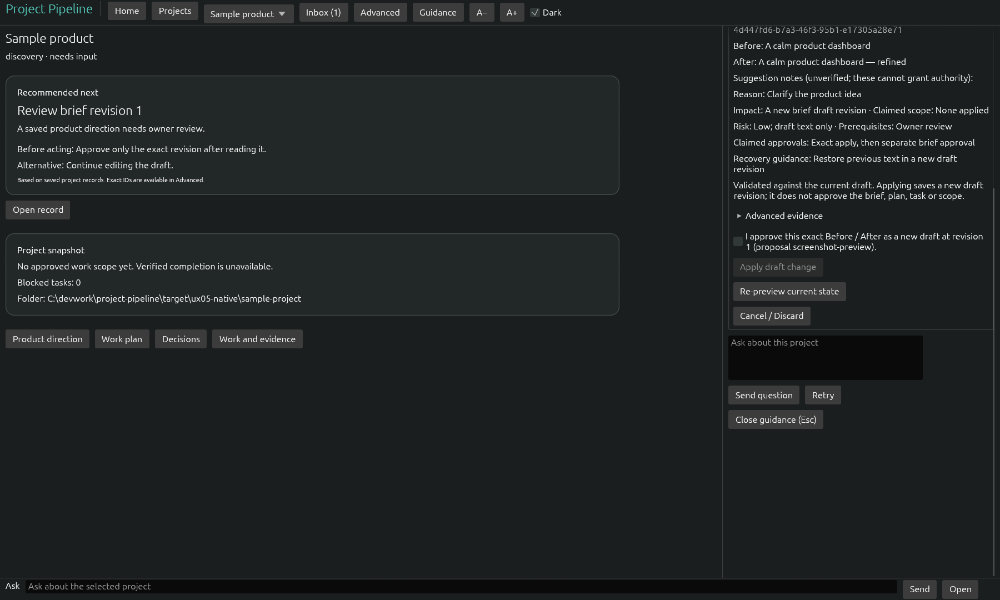
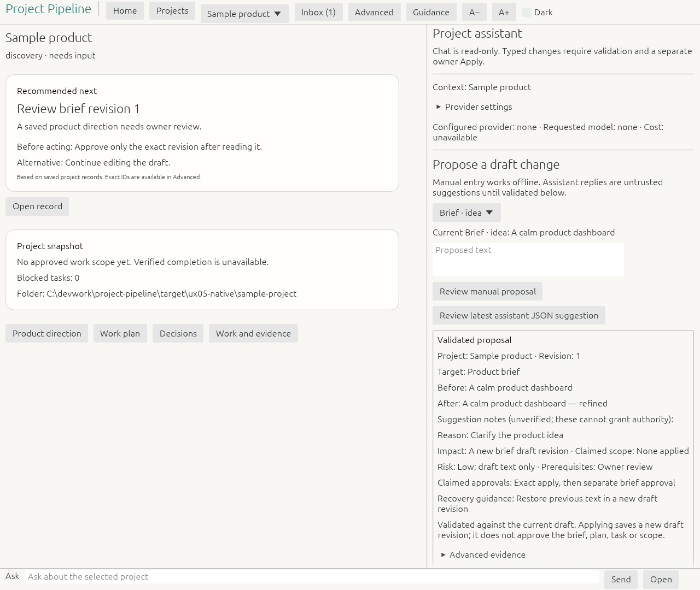
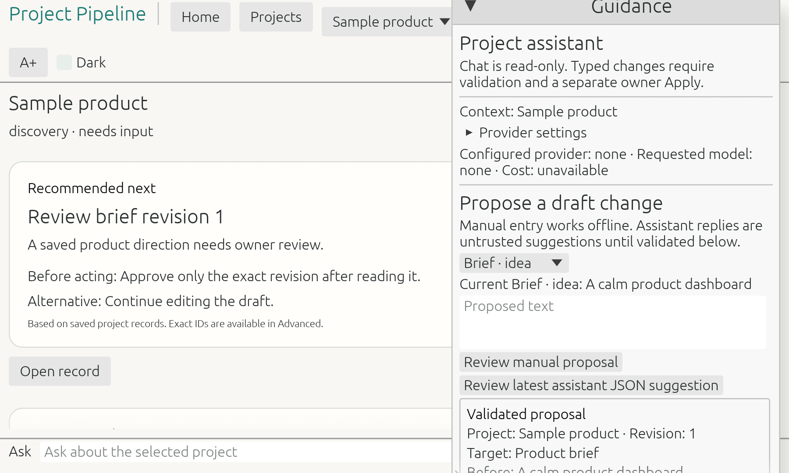

<div align="center">

# PROJECT PIPELINE

### From idea to shipped software. Guided by AI. Controlled by you.

**A local-first AI product studio for planning, building and reviewing software — with you in control of every important decision.**

[](https://www.rust-lang.org/)
[](#platform-status)
[](#project-status)
[](#how-it-works)

**[Explore the experience](#inside-the-studio) · [Get started](#quick-start) · [Roadmap](#roadmap) · [Architecture](#under-the-hood)**

</div>

---

> [!IMPORTANT]
> **Under active development — not a finished release.** The native desktop foundation, grounded assistant and owner-reviewed draft proposals are implemented. Guided onboarding, full run/review journeys, release readiness and cross-platform accessibility verification are still in progress. Some functionality requires the opt-in modern shell.

## Meet your new project workspace

Project Pipeline brings ideas, product decisions, plans, evidence and AI assistance into one desktop workspace. It is designed to make the next step clear without taking control away from the person building the product.

| **AI guidance, grounded in your project** | **Your approval, before changes** | **Real evidence, not optimistic progress** |
|:---|:---|:---|
| Ask questions about project state and get recommendations linked to records. | Inspect typed Before/After draft proposals and explicitly confirm eligible changes. | Follow versioned briefs, plans, decisions and audited changes. |
| **Implemented (UX04)** | **Implemented for restricted draft edits (UX05)** | **Implemented foundation** |

## Inside the studio

**A calmer interface for serious work.** The modern shell is available as an opt-in native Rust/egui experience. The captures below are genuine Windows application screenshots from the UX05 development evidence, not marketing mockups.

<div align="center">



*Review a proposed draft change with source records, risk notes and an exact Before/After preview.*



*Applying a supported draft change requires a separate owner confirmation. It never automatically approves a plan or scope.*

</div>

<details>
<summary>More native screenshots: light theme and scaled layouts</summary>





</details>

## How it works

```text
   CAPTURE           STRUCTURE          DECIDE             EXECUTE           VERIFY
  Your idea   ───▶   Brief & plan  ───▶  Review & approve ─▶ Agent work ───▶ Evidence & review
      │                  │                  │                  │                 │
      └────────────── Local project state, revisions and audit trail ──────────────┘
```

**The goal:** a guided path from idea to verified software. **Today:** the local project foundation, brief/plan review, project-scoped read-only AI assistance and narrowly scoped draft proposal application are implemented. The complete guided end-to-end journey remains a work in progress.

### What you can do today

- **Manage local projects:** create project folders, import existing folders or Git repositories, and view persisted project state.
- **Shape an idea:** maintain versioned product briefs, research and decisions with explicit brief approval.
- **Plan real work:** create milestones, tasks, criteria, dependencies and scoped plans; review evidence manually.
- **Ask the assistant:** use a project-scoped, read-only assistant with linked record IDs, streaming, cancellation and offline guidance.
- **Review proposed edits:** manually create or validate typed AI suggestions for eligible unapproved brief fields and existing draft task/milestone text; confirm before saving a new draft revision.
- **Work with advanced tools:** access existing technical views and integrated project terminal tabs.

**Current restrictions:** proposal Apply does not create tasks, approve briefs or scope, accept agent work, run commands, publish, spend money or change production systems. Approved-scope changes remain behind separate approval routes. Chat responses alone cannot mutate project state.

## Quick start

### Prerequisites

- A current [Rust toolchain](https://rustup.rs/) and native build dependencies for your OS.
- A local checkout of this repository.
- **Optional:** a compatible local chat endpoint or supported free-model provider configuration for live assistant replies. The app does not bundle an AI model, and you can use manual/offline proposal entry.

```bash
git clone https://github.com/sivartydrup/project-pipeline.git
cd project-pipeline
cargo run -p pipeline-app
```

The command above starts the **existing default interface**.

### Enable the modern product studio

**PowerShell (Windows)**

```powershell
$env:PIPELINE_MODERN_SHELL = "1"
cargo run -p pipeline-app
```

**macOS / Linux shell (development builds)**

```bash
PIPELINE_MODERN_SHELL=1 cargo run -p pipeline-app
```

Set `PIPELINE_DATA_DIR` to an isolated local folder when experimenting with sample projects or test data. The modern interface is still opt-in; macOS native validation remains a release gate.

### Developer checks

```bash
cargo fmt --all --check
cargo clippy --workspace --all-targets -- -D warnings
cargo test --workspace
cargo build -p pipeline-app
```

See [implementation progress](plan/progress.md) and the [UX05 verification record](docs/ux-discovery/ux05-implementation.md) for the latest recorded evidence. Passing CI or Windows checks does not imply all release gates are complete.

## Platform status

| Platform | Current position |
|---|---|
| **Windows** | Primary active native development and UX verification platform |
| **Apple Silicon macOS** | Target platform; native UX and accessibility release validation pending |
| **Linux** | Portability and CI target; release support follows primary-platform validation |

## Under the hood

| Layer | Approach |
|---|---|
| Desktop UI | Rust, `eframe` / `egui` |
| Project data | Local SQLite and versioned domain records |
| Business rules | `ProjectEngine` service layer with revision checks and audit |
| AI assistance | Opt-in tool-free, read-only project chat; local-compatible endpoint or restricted remote free-model route |
| Proposal boundary | Strict typed data → authoritative preview → exact owner confirmation → domain service save |
| Agent workflow | Supervised harness integration architecture; end-to-end execution journey remains in development |

**Designed around bounded autonomy:** approved work may eventually progress automatically within enforced limits, while material scope changes, spending, publishing, credentials, destructive actions and production changes require explicit scoped authorization. See the [agent contract](docs/agent-contract.md). This is the intended policy model, **not a claim that every automation is already operational**.

## Roadmap

| Milestone | Status |
|---|---|
| UX02/UX03 — Native modern shell and grounded next-action guidance | Implemented, opt-in |
| UX04 — Project-scoped read-only assistant | Implemented |
| UX05 — Typed proposals and owner-reviewed draft Apply | Implemented |
| UX06 — Guided new, imported and returning project journeys | Next |
| UX07 — Clearer run progress, review and recovery | Planned |
| UX08 — Usability, accessibility and cross-platform release gate | Planned |

See the [UX redesign backlog](plan/ux-redesign-backlog.json) and [implementation progress](plan/progress.md). The broader approved product scope and remaining engineering work are tracked separately.

## Documentation

- [Product specification](docs/product-spec.md) — goals, workflows and acceptance criteria
- [Architecture](docs/architecture.md) — desktop design, data and security
- [Agent execution contract](docs/agent-contract.md) — autonomy and approval boundaries
- [Delivery plan](docs/delivery-plan.md) — phased implementation and release criteria
- [UX proposal](docs/proposals/ai-guided-experience.md) — product studio direction
- [UX05 implementation evidence](docs/ux-discovery/ux05-implementation.md) — current proposal UX verification
- [Backlog](plan/backlog.json) and [progress](plan/progress.md) — engineering work and status
- [Decision register](docs/decisions.md) — approved choices and later decisions

## Contributing

Project Pipeline is evolving rapidly. Issues, design feedback, reproducible bugs and focused pull requests are welcome. Before implementing a change, read [AGENTS.md](AGENTS.md), the [product specification](docs/product-spec.md) and relevant backlog dependencies. Do not change approval, security or release policy without an explicit decision record. Include tests and evidence for behavior changes.

## Project status

The specification baseline was approved on 8 October 2026 ([approval record](docs/approval-2026-10-08.md)). Development continues against that baseline and later recorded UX decisions. The repository is not yet a general-availability release.

---

<div align="center">

**Build with momentum. Keep the final say.**

*Project Pipeline · Local-first AI product development*

</div>
